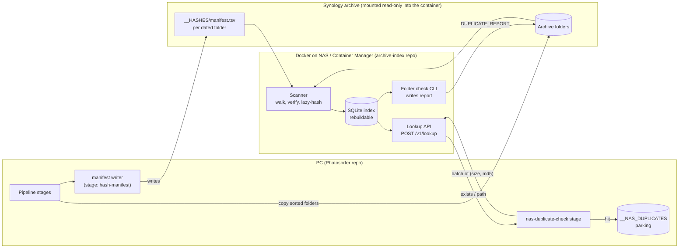
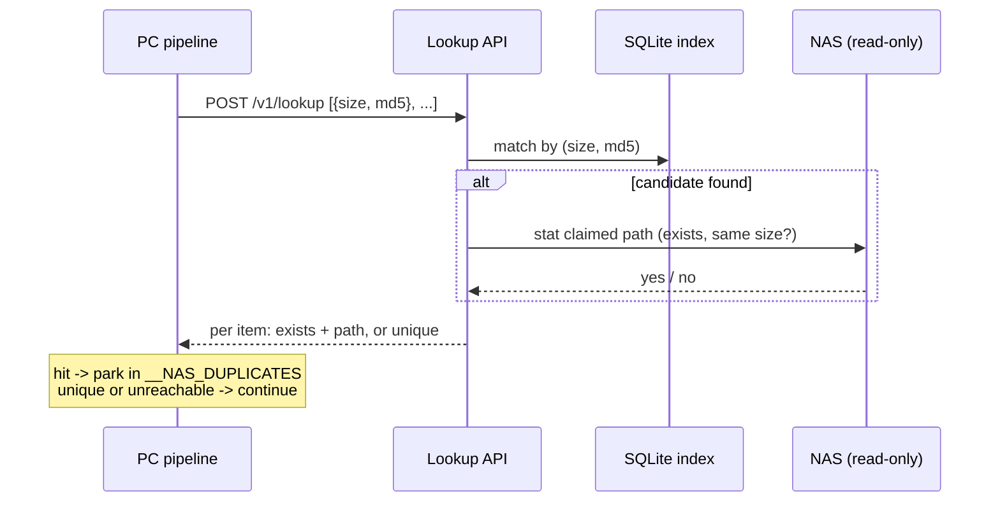
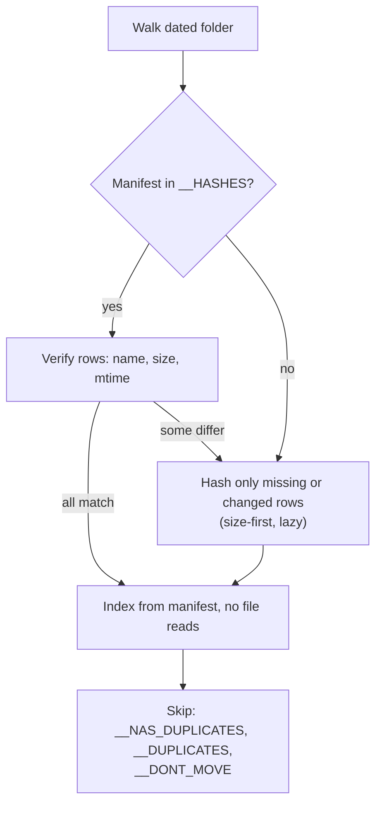

# NAS archive index — design

**Status:** draft for review · **Date:** 2026-11-08 · **Decides:** architecture, repo split, contract
**Nothing here is built.** Per AGENTS.md, a decided rule is not an implemented one.

## 1. Problem

The permanent archive lives on a Synology NAS (DSM runs as a Proxmox VM). It is not
indexed, and only partly follows `ARCHIVE_STANDARD.md`. Two questions need an answer:

1. **PC pipeline:** is this file already on the NAS?
2. **NAS folders** (old drives, phone uploads): which files in this new folder are
   duplicates of what the archive holds, and which are unique?

## 2. Decisions taken in the interview

| Topic | Decision |
|---|---|
| "Duplicate" | **Byte-identical only**, for stills, videos and sidecars alike. Derivatives (panoramas, extracted video/audio, geodata) are duplicates only if their bytes match. No relationship graph. |
| Action on a hit | **Park**, never delete: PC files go to `__NAS_DUPLICATES` (distinct from the local `__DUPLICATES`). |
| Scale | 100k–1M files; total size to be measured (§11). |
| Hash | **MD5 + size**, matching `src/utils/checksums.py:file_md5` (T8). An `algo` column allows a later migration. |
| Source of truth | **Per-folder manifest in `__HASHES`**; the database is a rebuildable index. |
| Per-asset sidecars | Rejected: doubles the file count, goes stale on rename/edit, complicates pairing. |
| Hosting | **Docker container on the NAS** (Container Manager, installed), archive bind-mounted **read-only** (`:ro`), database on a separate folder outside the archive tree. Replaces the earlier Proxmox-LXC idea: the LXC shares the host with the NAS, so it adds no availability (§3, placement). |
| PC ↔ NAS | Batch lookup API. Offline fallback: skip with a warning (snapshot fallback is optional, §8). |
| NAS-side check | **Manual**: you point it at a folder; it writes a report file into that folder. |
| Sorted, hierarchical copies | Already checked; they skip the duplicate report, and are indexed from their manifest. |
| Thematic folders | **Out of scope** (§12). Indexing is by content, not by path. |

## 3. Architecture



### Lookup sequence



### Scan and rebuild



### Placement compared

SQLite must live on the same machine as the process that opens it. A database file on
an SMB share opened from another host is excluded in every variant (locking is
unreliable and the file can corrupt).

The LXC and the DSM VM run on one Proxmox host, so they are up or down together. That
removes "separate VM" as an availability advantage.

| | **Docker on the NAS** (chosen) | **Separate Proxmox LXC** | **On the PC** |
|---|---|---|---|
| Scan speed | Best: reads the local volume directly | Good: reads over the virtual bridge, through the DSM VM's NFS/SMB | Worst: all reads cross physical gigabit (about 110 MB/s) |
| Available when the PC is off | Yes | Yes (no better than Docker: same host) | No; the NAS-side folder check needs the PC |
| PC pipeline lookup | Network call; skip-and-warn when down | Same | Local file, fast, works offline |
| Read-only guarantee | Bind mount `:ro`, enforced by the kernel | OS-level read-only mount | Only the SMB permissions you give it |
| Setup | Container Manager already installed; fewest moving parts | One more Linux guest to maintain | Python plus a SQLite file |
| Backup and recovery | Copy the DB file; rebuild from manifests | Cheap LXC snapshot | Keep the DB outside Dropbox (conflict risk) |
| Main risk | A DSM update could affect Container Manager | An extra machine to patch, for no availability gain | Folder check not available when the PC is off |

**Choice:** Docker on the NAS, with the PC keeping an optional read-only hash-set
snapshot (§8) for offline runs. The LXC remains a fallback if Container Manager
misbehaves. The index is rebuildable from manifests, so moving it later costs a rescan.

## 4. Repo decision

**Separate repo (`archive-index`)** for the scanner, API and folder-check CLI.
**Photosorter** gains two stages only: manifest writer and NAS duplicate check.

Why separate: different runtime (Linux container vs Windows-only pipeline), different release
cadence, and Photosorter should not grow a server. Why not Pact: one consumer, one
provider, both owned by you; a shared schema plus fixtures gives the same safety for
less ceremony.

**The contract has two parts:**

1. **Manifest format** — a new rule in `ARCHIVE_STANDARD.md` (§4 `__HASHES`, §8 YAML),
   which is already written to be handed to third-party tools. It is the real contract:
   the pipeline writes it, the indexer reads it.
2. **Lookup API** — an OpenAPI/JSON Schema file in the `archive-index` repo. Photosorter
   vendors a copy and runs pytest contract checks against recorded fixtures; the
   indexer runs the same fixtures in its own tests. Schemathesis can fuzz the provider.

## 5. Manifest format (draft, for ARCHIVE_STANDARD)

`<dated folder>/__HASHES/manifest.tsv`, UTF-8, tab-separated, one header line:

```
# archive-manifest v1
name<TAB>size<TAB>mtime_ns<TAB>algo<TAB>digest
IMG_0001.jpg    4821733    1731027412000000000    md5    9e107d9d372bb6826bd81d3542a419d6
```

- Paths are relative to the folder; names are exactly as on disk.
- A manifest describes its own folder's direct files only. Subfolders carry their own.
- Rows are advisory: a size or mtime mismatch means "re-hash", never "trust".
- Tool-written, replaced atomically (write temp, rename), never edited by hand.
- `__HASHES` itself is excluded from the manifest.

## 6. Lookup API (draft)

`POST /v1/lookup`

```json
{ "items": [ { "size": 4821733, "algo": "md5", "digest": "9e10..." } ] }
```

```json
{ "results": [ { "found": true, "path": "2024/03. March/2024-03-09 Trip/IMG_0001.jpg" },
               { "found": false } ] }
```

- Batches of up to a few thousand items per call; the PC sends one batch per folder.
- `found: true` is only returned after the service **stats the claimed path** and
  confirms the size (§7, rule 3).
- `GET /v1/health` returns index age and file count. The PC stage uses it to decide
  whether to trust answers.

## 7. Safety rules

1. The indexer container mounts the archive **read-only** (`:ro`) and never edits it. Hashes of
   manifest-less folders live in the DB only; a separate explicit `seal <folder>`
   command run from the PC writes the missing manifest.
2. `__NAS_DUPLICATES`, `__DUPLICATES` and `__DONT_MOVE` are excluded from the index,
   so a parked file never counts as "already safe".
3. **"Exists" is verified at answer time** (stat plus size). A stale index can only
   miss a duplicate, which is harmless. It cannot claim a copy that is gone.
4. The PC stage **parks, never deletes**, and reuses the existing checksum-before-move
   discipline (F4a): the park is a rename within the same filesystem, journalled.
5. API unreachable, or index older than a configured age: the stage warns and skips;
   the pipeline continues unchanged.

## 8. PC offline fallback

Skip with a warning is the default. An optional **hash-set snapshot** (a sorted file of
`size:md5`, about 40–80 MB for 1M files) can be synced to the PC. A snapshot hit is
only a **candidate**: it parks nothing until the live check confirms, or until the
user accepts snapshot-only parking in config. Decide this after the first version
proves useful.

## 9. Manual moves into the archive

| Case | Behaviour |
|---|---|
| Folder arrives with its manifest | Spot-check size/mtime, index with no content reads. |
| No manifest, or mismatching rows | Hash only the missing/changed rows. |
| Folder moved/renamed inside the NAS | Same digest at a new path is a move: update the path, re-hash nothing. |
| Files deleted | A rescan drops rows whose path no longer exists. |

Rescan is on demand, plus an optional nightly task. A cheap pass (listing size/mtime)
runs first; hashing happens only for rows that need it.

## 10. NAS-side folder check

`archive-index check <folder>` hashes the folder's files (size-first, so only
size-matching files are read), compares them to the index, and writes
`<folder>/DUPLICATE_REPORT.txt`: counts of unique and duplicate files, and for each
duplicate the existing archive path. It moves nothing.

## 11. Operations

- **Backup:** nightly SQLite online backup to a folder outside both the archive and the live DB folder. The DB is rebuildable, so a VM snapshot is optional.
- **Recovery:** delete the DB and rescan; manifests make that fast.
- **Measure first** (run on the Synology or the mount):

  ```bash
  du -sh /volume1/photo; find /volume1/photo -type f | wc -l
  ```

- **Docker:** Container Manager is installed on the NAS. Verify once that a container can
  bind-mount the photo volume read-only and that the DB folder is writable.

## 12. Out of scope

- Thematic folders (weddings, photoshoots): a layout question, separate from duplicates.
- Perceptual or near-duplicate detection.
- Any deletion on either side.
- Derivative-of-original relationships (panoramas, extracted media).

## 13. Build order

1. Manifest rule in `ARCHIVE_STANDARD.md`, and a manifest writer stage in the pipeline.
2. `archive-index` repo: scanner and SQLite schema; rebuild from manifests.
3. Lookup API with the stat-verify rule, plus the contract fixtures.
4. PC `nas-duplicate-check` stage and `__NAS_DUPLICATES` parking.
5. `check` CLI and report file; `seal` command.
6. Optional: snapshot fallback.

## 14. Open items

- Archive size and file count (§11).
- Whether the DSM VM's volume is fast enough for the first scan (disk passthrough vs virtual disk on Proxmox).
- Where `__NAS_DUPLICATES` sits (sibling of what it parks, like other parking areas, §4.1).
- Whether `mtime` survives your usual copy method; if not, rows verify on size alone and re-hash more.
